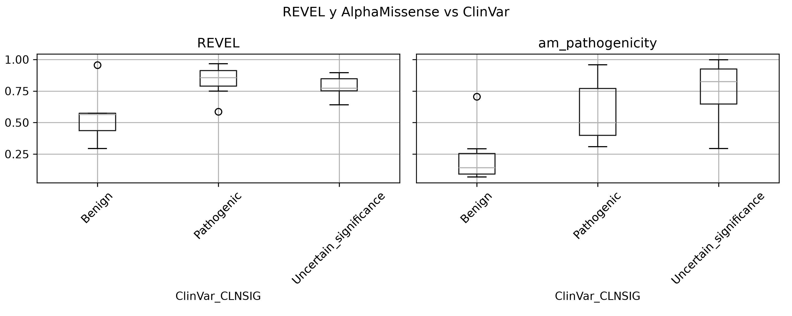

# MYH7 Variant Annotation & Clinical Interpretation (HCM)

A clinical bioinformatics portfolio project focused on the annotation, population frequency filtering, *in silico* predictor benchmarking, and manual ACMG/ClinGen curation of **26 missense variants** in the ***MYH7*** gene associated with **Hypertrophic Cardiomyopathy (HCM)**.

## Objectives

1. Annotate a curated dataset of *MYH7* missense variants (**10 Pathogenic, 10 VUS, 6 Benign** from ClinVar) using **Ensembl VEP (GRCh38)**.
2. Filter variants by population allele frequency (**gnomAD**) and evaluate the concordance of **REVEL** and **AlphaMissense** against ClinVar reference classifications.
3. Perform manual clinical curation on a representative subset of 5 variants applying the **ClinGen Cardiomyopathy VCEP specifications for *MYH7* v2.0 (GN002)** and cross-checking results with **Franklin**.

---

## Repository Structure

```text
.
├── data/
│   ├── variant_input.txt          # Original 26 MYH7 missense variants (HGVS)
│   └── ...                        # VCF input & Ensembl VEP annotated output
├── scripts/
│   └── analyze_variants.py        # Data cleaning, gnomAD filtering & plotting
├── results/
│   ├── vep_clean.csv              # Deduplicated canonical MYH7 variant table
│   ├── benchmark.png              # REVEL & AlphaMissense vs. ClinVar boxplots
│   └── manual_acmg.csv            # Manual ACMG/ClinGen v2.0 curation (5 variants)
└── README.md
```

---

## Workflow

1. **Variant Selection:** 26 missense variants on the canonical transcript `NM_000257.4` (*MYH7*) selected from ClinVar across three categories (*Pathogenic*, *Uncertain_significance*, *Benign*) and formatted as GRCh38 VCF.
2. **Functional Annotation:** Annotated via **Ensembl VEP** to retrieve canonical consequences, **gnomAD** allele frequencies, ClinVar clinical significance, **REVEL**, and **AlphaMissense** scores.
3. **Python Processing (`scripts/analyze_variants.py`):**
   * Filters for canonical *MYH7* records and deduplicates variants by genomic location and alleles.
   * Flags rare variants (`gnomAD_exomes_AF < 0.001` or absent in gnomAD).
   * Exports `results/vep_clean.csv` and generates `results/benchmark.png`.
4. **Manual ACMG/ClinGen Curation:** 5 informative variants were manually interpreted following **ClinGen *MYH7* v2.0 (GN002)** rules (`BA1`, `BS1`, `PM1`, `PM2_Supporting`, `PP3`, `BP4`) and verified using **Franklin**.

---

## Key Findings



* **REVEL vs. AlphaMissense:** **REVEL** consistently assigns high scores (`> 0.75`) to *Pathogenic* variants, whereas **AlphaMissense** achieves tighter separation for *Benign* variants (`< 0.30`) but exhibits greater dispersion among *Pathogenic* variants.
* **VUS Overprediction in *MYH7*:** Both *in silico* tools assign high pathogenicity scores to *Uncertain_significance* (VUS) variants, reflecting the high evolutionary conservation of *MYH7* and demonstrating why computational scores alone cannot upgrade a VUS.
* **Population Frequency Overrides *In Silico* False Positives:** A benign outlier (`c.2945T>C`) receives damaging scores from both REVEL (`0.956`) and AlphaMissense (`0.705`), yet is conclusively classified as *Benign* due to its high allele frequency in gnomAD (`BA1`).

---

## Manual Curation Summary (ClinGen *MYH7* v2.0)

| Variant (`NM_000257.4`) | Region | ClinVar | gnomAD AF | REVEL / AM | Applied ACMG Criteria | Final Class | Clinical Takeaway |
| :--- | :--- | :--- | :--- | :--- | :--- | :--- | :--- |
| `c.4472C>G` | Rod (aa 1491) | Benign | `1.19e-02` | `0.398` / `0.142` | `BA1`, `BP4` | **Benign** | Textbook benign: high population frequency concordant with low *in silico* scores. |
| `c.2945T>C` | Rod (aa 982) | Benign | `1.74e-03` | `0.956` / `0.705` | `BA1` *(overrides PP3)* | **Benign** | False-positive *in silico* outlier ruled out by stand-alone population frequency. |
| `c.2513C>T` | Motor (aa 838) | Pathogenic | Absent | `0.923` / `0.957` | `PM1`, `PM2_Supp`, `PP3` *(+ clinical)* | **Pathogenic** | Absent in gnomAD, located in critical motor domain (`aa 167–931`), concordant predictors. |
| `c.2681A>G` | Motor (aa 894) | Pathogenic | `2.05e-06` | `0.966` / `0.396` | `PM1`, `PM2_Supp`, `PP3` *(+ clinical)* | **Pathogenic** | Predictor discordance: strong REVEL score in motor domain vs. ambiguous AlphaMissense. |
| `c.5302G>A` | Rod (aa 1768) | VUS | Absent | `0.856` / `0.997` | `PM2_Supp`, `PP3` | **VUS** | Extreme *in silico* scores (`AM = 0.997`) + absence in gnomAD are insufficient without clinical/segregation data. |

*Note: confirming `Pathogenic` status under ACMG/ClinGen requires clinical case/segregation evidence such as `PS4`/`PP1` beyond bioinformatic criteria alone.)*

---

## How to Run

```bash
pip install pandas matplotlib
python scripts/analyze_variants.py
```

---

## References

* Richards et al. (2015). *Standards and guidelines for the interpretation of sequence variants*. Genetics in Medicine.
* ClinGen Cardiomyopathy Variant Curation Expert Panel (VCEP). *Specifications to the ACMG/AMP Variant Interpretation Guidelines for MYH7, Version 2.0* ([CSpec GN002](https://cspec.genome.network/cspec/ui/svi/doc/GN002)).
* Ensembl Variant Effect Predictor (VEP), gnomAD, ClinVar, and Franklin by Genoox.